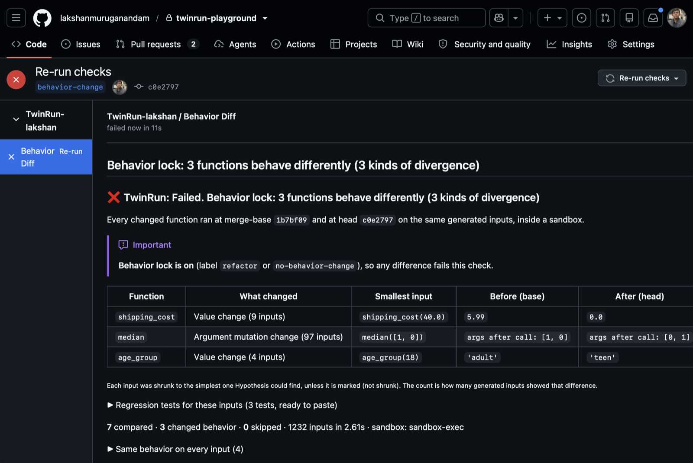

# End-to-end run on GitHub (31 Oct 2026)

Setup: `twinrun create-app` (manifest flow) created the private app **TwinRun-lakshan** (id 5554869).
It was installed only on the private repo `lakshanmuruganandam/twinrun-playground` (installation
177201337, permissions `checks:write, contents:read, metadata:read, pull_requests:write`, event
`pull_request`). `twinrun serve` ran locally behind `npx smee-client`.

## PRs

| PR | change | labels | result |
|---|---|---|---|
| #1 | `age < 18` → `age <= 18`, `FREE_SHIPPING_MIN = 50` → `40` | none | 🟡 neutral: 2 functions diverge |
| #2 | extract `_check_percent` helper, `len([...])` → `sum(1 for ...)` | `refactor` | ✅ success: no behavior change in 2 compared functions |
| #1, 2nd push | + `age < 65` → `age < 60` | none | 🟡 neutral, **same comment updated** |
| #1, label added | — | `refactor` | ❌ failure: behavior lock |

## Server log (what each webhook produced)

```
16:30:46 INFO PR #1 c08f633: neutral; comment 6543383645 (created)
16:30:47 INFO PR #2 0ec2e35: success; comment 6543383727 (created)
16:30:53 INFO PR #2 0ec2e35: success; comment 6543383727 (updated)   <- 'labeled' event
16:31:20 INFO PR #1 324d3fe: neutral; comment 6543383645 (updated)   <- new push
16:31:32 INFO PR #1 324d3fe: failure; comment 6543383645 (updated)   <- refactor label added
```

## Verified with `gh api`

```
$ gh api repos/lakshanmuruganandam/twinrun-playground/commits/<PR1 head>/check-runs
Behavior Diff | completed | neutral | app=twinrun-lakshan | 2 function(s) behave differently (2 kind(s) of divergence)

$ gh api repos/lakshanmuruganandam/twinrun-playground/commits/<PR2 head>/check-runs
Behavior Diff | completed | success | app=twinrun-lakshan | No behavior change in 2 compared function(s)

# after the second push + refactor label on PR #1:
Behavior Diff | failure | Behavior lock: 2 function(s) behave differently (2 kind(s) of divergence)
bot comments on PR #1: 1
```

PR #1 comment table (head `324d3fe`):

| function | divergence | smallest input | base output | head output |
|---|---|---|---|---|
| `shipping_cost` | value change ×9 | `shipping_cost(40.0)` (not shrunk) | `5.99` | `0.0` |
| `age_group` | value change ×4 | `age_group(18)` | `'adult'` | `'teen'` |

`age_group(18)` is the Hypothesis-shrunk witness. For `shipping_cost`, `find()` found nothing
simpler than the smallest input already seen, so that row is honestly marked "(not shrunk)".



## v0.2.0 re-check (same day)

After adding generated regression tests, the server was restarted on the new code, and PR #1 got one more
commit (`median` now sorts its argument in place). The same comment was updated (still **1** bot comment),
and the check found three functions, including the new **argument mutation change** for `median([1, 0])`.

The regression-test block was then copied **out of the live GitHub comment** and run against both branches:

```
main:            3 passed
behavior-change: 3 failed
```
